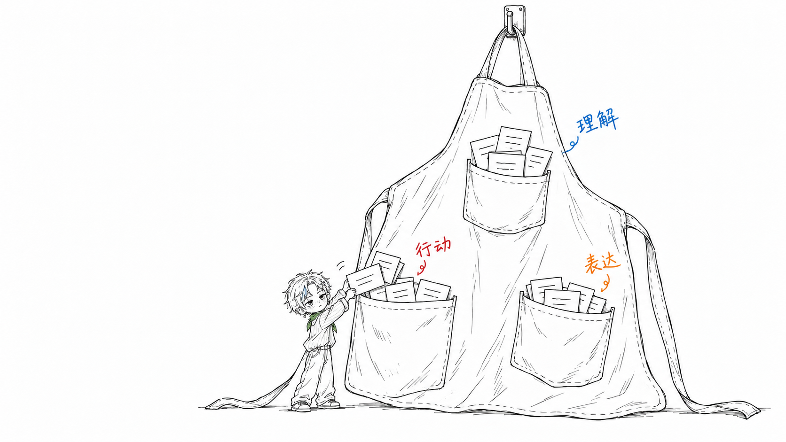
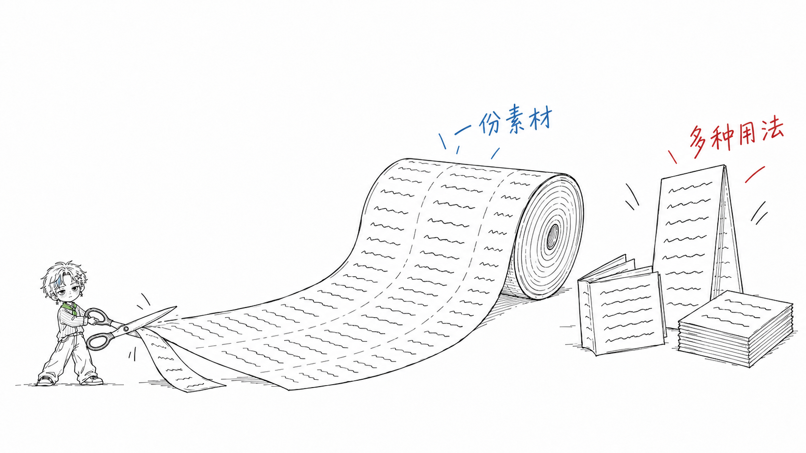
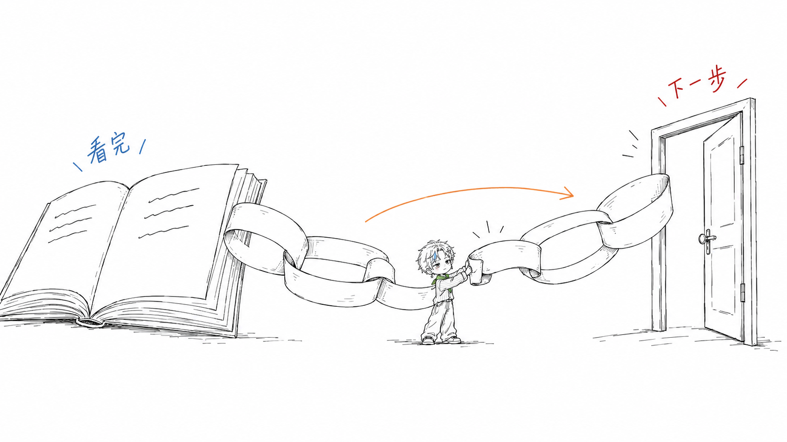
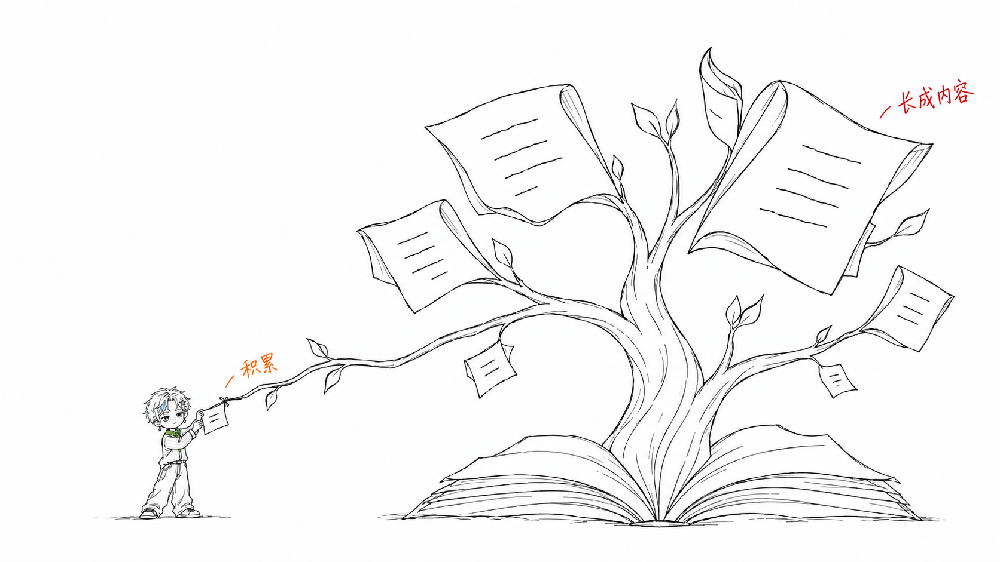
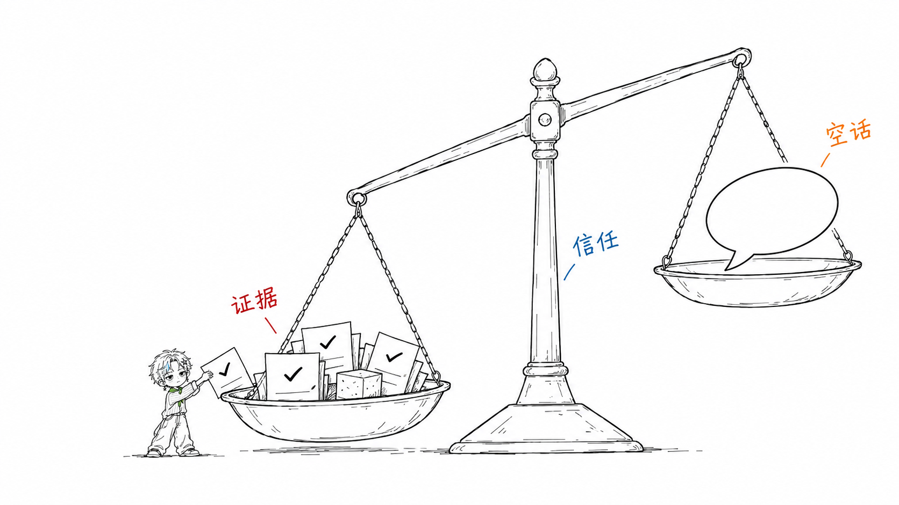

# 小星 8 主题案例：生成记录

这 8 张图由 Codex 内置 `image_gen` 分别生成，使用的 Skill 版本为 [`30924f6`](https://github.com/liaoyio/oooyi-illustrations/blob/30924f6d6dcc5229f34884200bab8973bf7a84a2/oooyi-illustrations/SKILL.md)。每张都重新设计了物理隐喻，没有复用旧小黑成图。

实际调用使用 `referenced_image_paths`，按以下顺序传入三张本地参考；这里用固定版本的仓库链接标明来源。`transparent_background` 为 `false`，没有使用 `num_last_images_to_include`。

1. [脸部基准](https://github.com/liaoyio/oooyi-illustrations/blob/30924f6d6dcc5229f34884200bab8973bf7a84a2/oooyi-illustrations/references/character/face-closeup.jpg)：脸型、短发、星星发夹与耳坠。
2. [全身基准](https://github.com/liaoyio/oooyi-illustrations/blob/30924f6d6dcc5229f34884200bab8973bf7a84a2/oooyi-illustrations/references/character/front-fullbody.jpg)：服装与配饰设计。
3. [信息过滤成图](https://github.com/liaoyio/oooyi-illustrations/blob/30924f6d6dcc5229f34884200bab8973bf7a84a2/examples/images/filtering.png)：只校准细黑线、留白和远景人物尺度，不沿用物件。

以下保留最终采用的完整提示词。人物过大的初稿未选用；入选图没有经过局部编辑或图像后处理。尺寸与人物占比按成品检查，占比为发顶至鞋底的手工估计，不把提示词里的目标尺寸当作实际结果。再次生成时，构图和细节可能不同。

## 01 · 补上两处断点

小星双手把软管套筒接好，另一处套筒已经闭合，水流沿接通的软管进入洒水壶。


实际输出为 1672 × 941 PNG，小星全身约占画面高度的 27.2%。

<details>
<summary>完整生成提示词</summary>

```text
Generate one NEW standalone 16:9 horizontal Chinese article sketch, approximately 1672x941 pixels, fine slightly wobbly BLACK hand-drawn pen lines on PURE WHITE. Big empty wide establishing shot.
Reference 1 is Xing's face identity, reference 2 his outfit identity. Ignore their 3D rendering, lighting, framing and broad colors. Reference 3 calibrates ONLY fine sketch density, distant full-body character SCALE and pure-white negative space; DO NOT inherit its sieve, keys, scraps, tray or layout.
FIRST place the oversized physical metaphor across the wide middle/right, around 40%-60% of the page area, leaving at least 35% fully blank pure white and a large quiet region above. THEN place the TINY STANDING full-body Xing near the extreme lower-left. His complete hair-to-shoes height should be only 160-190 pixels in a 941-high canvas, around one fifth of the image; NEVER over one third. Make him even smaller than the character in reference 3. No kneeling or sitting, no close-up, no central enlarged anime character; do not enlarge him to show accessories. Both shoes completely visible.

CHARACTER LOCK, hand-drawn render (reuse verbatim, do not alter):
Xing, a tiny cool boy drawn in loose black hand-drawn line art (slightly wobbly pen lines; NOT 3D, NOT photorealistic, NOT polished render; draw him as a BOY, never as a little girl): short tousled blonde hair with a blue-grey streak doodle in the front bangs; silver star hair clip doodle on the left side; star drop earring doodle on the left ear; boyish face, big eyes with a distant deadpan gaze, blush lines and freckle dots on cheeks; oversized pinstripe shirt doodle; green neckerchief (light green wash ONLY on the neckerchief); baggy jeans; white sneakers; cool expressionless face. Tiny figure in a wide shot: full body no more than ~1/3 of the canvas height (aim ~1/4); never a close-up.

Palette and style: all physical objects, skin, hair contour, blush hatching, freckles, eyes and clothes are BLACK lines with WHITE interiors. White outlined short tousled hair represents pale blonde, not yellow fill. Pale blue-grey ONLY in the one front hair streak; pale green ONLY on his neckerchief. All other color confined to the specified tiny red/orange/blue handwritten side notes. No colored materials, no blue objects or water, no skin tone, no colored jeans. Minimal fine slightly imperfect pen lines, no broad gray fill, shadows, gradients, texture, noise, beige paper, 3D, realism, commercial vector, polished manga or thick cartoon outlines. A cool boy with star hair clip, star drop earring, freckles, striped shirt, scarf, wide trousers and sneakers, not a girl. He personally performs the conceptual work, not a bystander.
No top-left title, no watermark, no logos, no infographic panels, formal flowchart, PPT, boxes, numbering, repeated figures or dense labels. No old conveyor, bridge, fermentation jar, star dough or filtering sieve.

Theme: 补上两处断点 — a chain becomes useful only when both missing connections are repaired.
Physical metaphor: ONE enormous soft garden hose snakes loosely across the wide middle of the page. It has TWO interrupted joints, each repaired by a simple oversized sleeve coupling. The farther-right joint is already connected firmly by its closed sleeve; the lower-left joint is visibly being repaired by Xing now, so both crucial joins are evident. Tiny standing Xing, at extreme lower-left, personally holds the sleeve with both hands and pushes the two hose ends into it. Keep his whole figure around 180 pixels high; make the hose coupling itself about as long as his body. The hose bends down close to his hands; do not make him large to reach it. The line continues from this worksite across to the second closed coupling and then ends in a small black-outline trickle into a simple unfilled watering pot. The entire hose and two sleeves are black outlines with white interiors; no blue water or metallic shading. Show only one hose, two joints, one small pot and the tiny worker. No dramatic machinery or scenery.
Exactly TWO small casual Chinese notes: red "补上" beside the active joint and orange "接通" near the distant already-closed joint. No other text or diagram arrows. The two repaired interruptions are the idea; not a diagram of equipment. Clear physical hand action, tiny calm boy, giant strange everyday object.
```

</details>

## 02 · 按用途分类

巨大的围裙有“理解”“表达”“行动”三个口袋。小星把外观相近的资料卡放进“行动”口袋，用途决定去处。



实际输出为 1672 × 941 PNG，小星全身约占画面高度的 32.2%。

<details>
<summary>完整生成提示词</summary>

```text
Generate one NEW standalone 16:9 horizontal Chinese article sketch, approximately 1672x941 pixels, fine slightly wobbly BLACK hand-drawn pen lines on PURE WHITE. Big empty wide establishing shot.
Reference 1 is Xing's face identity, reference 2 his outfit identity. Ignore their 3D rendering, lighting, framing and broad colors. Reference 3 calibrates ONLY fine sketch density, distant full-body character SCALE and pure-white negative space; DO NOT inherit its sieve, keys, scraps, tray or layout.
FIRST place the oversized physical metaphor across the wide middle/right, around 40%-60% of the page area, leaving at least 35% fully blank pure white and a large quiet region above. THEN place the TINY STANDING full-body Xing near the extreme lower-left. His complete hair-to-shoes height should be only 160-190 pixels in a 941-high canvas, around one fifth of the image; NEVER over one third. Make him even smaller than the character in reference 3. No kneeling or sitting, no close-up, no central enlarged anime character; do not enlarge him to show accessories. Both shoes completely visible.

CHARACTER LOCK, hand-drawn render (reuse verbatim, do not alter):
Xing, a tiny cool boy drawn in loose black hand-drawn line art (slightly wobbly pen lines; NOT 3D, NOT photorealistic, NOT polished render; draw him as a BOY, never as a little girl): short tousled blonde hair with a blue-grey streak doodle in the front bangs; silver star hair clip doodle on the left side; star drop earring doodle on the left ear; boyish face, big eyes with a distant deadpan gaze, blush lines and freckle dots on cheeks; oversized pinstripe shirt doodle; green neckerchief (light green wash ONLY on the neckerchief); baggy jeans; white sneakers; cool expressionless face. Tiny figure in a wide shot: full body no more than ~1/3 of the canvas height (aim ~1/4); never a close-up.

Palette and style: all physical objects, skin, hair contour, blush hatching, freckles, eyes and clothes are BLACK lines with WHITE interiors. White outlined short tousled hair represents pale blonde, not yellow fill. Pale blue-grey ONLY in the one front hair streak; pale green ONLY on his neckerchief. All other color confined to the specified tiny red/orange/blue handwritten side notes. No colored materials, no blue objects or water, no skin tone, no colored jeans. Minimal fine slightly imperfect pen lines, no broad gray fill, shadows, gradients, texture, noise, beige paper, 3D, realism, commercial vector, polished manga or thick cartoon outlines. A cool boy with star hair clip, star drop earring, freckles, striped shirt, scarf, wide trousers and sneakers, not a girl. He personally performs the conceptual work, not a bystander.
No top-left title, no watermark, no logos, no infographic panels, formal flowchart, PPT, boxes, numbering, repeated figures or dense labels. No old conveyor, bridge, fermentation jar, star dough or filtering sieve.

Theme: 按用途分类 — similar-looking information cards go where they will actually be used, rather than being grouped by where they came from.
Invented physical metaphor: ONE absurdly gigantic simple work apron hangs loosely from a bare hook in the middle-right of a white page. It has THREE oversized, unevenly spaced cloth pockets, each with a few same-looking blank information cards sticking out. Avoid a regular three-column grid: pockets have different sizes and crooked seams, one higher and two lower. On the apron, three small handwritten words indicate purpose, not source or file type: blue "理解" beside one pocket, orange "表达" beside the second, red "行动" beside the third.
Tiny standing Xing at the extreme lower-left personally sorts a same-looking card into the low left "行动" pocket with both hands; lower the pocket to his reach and make the apron giant above him. The COMPLETE boy is only around 160-190 pixels high, well below one third. The other cards look similar, with only a few black scribble lines, demonstrating that use determines placement. No email icons, app logos, folders, labeled screens or source names.
Apron and cards entirely black thin outline on white, no colored cloth or paper. Only the three specified small handwritten purpose notes carry blue/orange/red. Huge quiet white margin above and to the left. He is seriously doing the sorting, not posing.
```

</details>

## 03 · 一份素材多种用途

小星用大剪刀裁开同一卷素材，旁边是用相同纸张做出的册子、立牌和方形卡片。



实际输出为 1672 × 941 PNG，小星全身约占画面高度的 27.6%。

<details>
<summary>完整生成提示词</summary>

```text
Generate one NEW standalone 16:9 horizontal Chinese article sketch, approximately 1672x941 pixels, fine slightly wobbly BLACK hand-drawn pen lines on PURE WHITE. Big empty wide establishing shot.
Reference 1 is Xing's face identity, reference 2 his outfit identity. Ignore their 3D rendering, lighting, framing and broad colors. Reference 3 calibrates ONLY fine sketch density, distant full-body character SCALE and pure-white negative space; DO NOT inherit its sieve, keys, scraps, tray or layout.
FIRST place the oversized physical metaphor across the wide middle/right, around 40%-60% of the page area, leaving at least 35% fully blank pure white and a large quiet region above. THEN place the TINY STANDING full-body Xing near the extreme lower-left. His complete hair-to-shoes height should be only 160-190 pixels in a 941-high canvas, around one fifth of the image; NEVER over one third. Make him even smaller than the character in reference 3. No kneeling or sitting, no close-up, no central enlarged anime character; do not enlarge him to show accessories. Both shoes completely visible.

CHARACTER LOCK, hand-drawn render (reuse verbatim, do not alter):
Xing, a tiny cool boy drawn in loose black hand-drawn line art (slightly wobbly pen lines; NOT 3D, NOT photorealistic, NOT polished render; draw him as a BOY, never as a little girl): short tousled blonde hair with a blue-grey streak doodle in the front bangs; silver star hair clip doodle on the left side; star drop earring doodle on the left ear; boyish face, big eyes with a distant deadpan gaze, blush lines and freckle dots on cheeks; oversized pinstripe shirt doodle; green neckerchief (light green wash ONLY on the neckerchief); baggy jeans; white sneakers; cool expressionless face. Tiny figure in a wide shot: full body no more than ~1/3 of the canvas height (aim ~1/4); never a close-up.

Palette and style: all physical objects, skin, hair contour, blush hatching, freckles, eyes and clothes are BLACK lines with WHITE interiors. White outlined short tousled hair represents pale blonde, not yellow fill. Pale blue-grey ONLY in the one front hair streak; pale green ONLY on his neckerchief. All other color confined to the specified tiny red/orange/blue handwritten side notes. No colored materials, no blue objects or water, no skin tone, no colored jeans. Minimal fine slightly imperfect pen lines, no broad gray fill, shadows, gradients, texture, noise, beige paper, 3D, realism, commercial vector, polished manga or thick cartoon outlines. A cool boy with star hair clip, star drop earring, freckles, striped shirt, scarf, wide trousers and sneakers, not a girl. He personally performs the conceptual work, not a bystander.
No top-left title, no watermark, no logos, no infographic panels, formal flowchart, PPT, boxes, numbering, repeated figures or dense labels. No old conveyor, bridge, fermentation jar, star dough or filtering sieve.

Theme: 一份素材多种用途 — one source material is adapted into several useful outputs instead of making each from scratch.
New physical metaphor: ONE giant roll of manuscript paper lies unrolled loosely across the center-right of the white page. The paper has just a repeated little pattern of short black scribble-lines, no readable writing. Tiny standing Xing at extreme lower-left is personally CUTTING a narrow edge of this same long paper with an absurdly oversized pair of black-outline scissors, using both hands. His whole figure is only around 160-190 pixels high, well under one third; scissors handles and low paper edge come down to his hands.
Nearby on the right, loosely fan out THREE finished shapes made from the SAME paper: a folded little booklet, a tall folded standing poster and a short stack of square cards. They all repeat the source's same black scribble-line pattern so the shared origin is visible. Vary their angle and size rather than arranging a diagram grid. Keep one source roll, one scissors and these three paper results only. No fish, dough, star shapes, conveyor or machine. No screens or application UI.
Exactly TWO small handwritten Chinese notes: blue "一份素材" beside the source roll, red "多种用法" beside the group of three finished paper forms. No extra words or arrows. All paper, scissors and objects black outline with white interiors. A wide sparse one-worksite hand sketch, not an instructional step sheet or comparison chart.
```

</details>

## 04 · 承接路径

小星把纸链接好，将看完文章后的兴趣接到下一步。



实际输出为 1672 × 941 PNG，小星全身约占画面高度的 23.8%。

<details>
<summary>完整生成提示词</summary>

```text
Generate one standalone 16:9 horizontal Chinese article illustration, target 2048x1152: black hand-drawn line art on pure white background.
Use case: illustration-story.
CHARACTER LOCK, hand-drawn render (reuse verbatim, do not alter):
Xing, a tiny cool boy drawn in loose black hand-drawn line art (slightly wobbly pen lines; NOT 3D, NOT photorealistic, NOT polished render; draw him as a BOY, never as a little girl): short tousled blonde hair with a blue-grey streak doodle in the front bangs; silver star hair clip doodle on the left side; star drop earring doodle on the left ear; boyish face, big eyes with a distant deadpan gaze, blush lines and freckle dots on cheeks; oversized pinstripe shirt doodle; green neckerchief (light green wash ONLY on the neckerchief); baggy jeans; white sneakers; cool expressionless face. Tiny figure in a wide shot: full body no more than ~1/3 of the canvas height (aim ~1/4); never a close-up.

Reference roles: first image and second image are ONLY character design anchors, not rendering style, no 3D. The THIRD image sets thin slightly wobbly pen lines, sparse color, roomy pure white and distant TINY figure scale only; NEVER copy its sieve, keys, layout or objects. Compose a whole new scene.
Visual DNA: pure #FFFFFF blank white background, fine black pen lines with gentle handmade wobble. NOT vector, NOT thick cartoon outlines, NOT polished commercial artwork, NOT 3D. No paper grain, no texture, no gradients, no shadows, no grey background wash. Main scene uses 40%-60% of image, generous quiet blank space around it, no border. White lineart hair, no yellow fill; white lineart jeans, no blue denim fill. Green only in the small scarf, pale blue-grey only in a tiny hair streak. No other colored fill. Chinese labels only 1-3 handwritten brief notes, red/orange/blue. No English labels, no title, no legend, no formal diagram, no UI.
HARD SCALE: Xing is a fully visible standing boy in a WIDE establishing shot, target full body 18%-22% of canvas height, around 180px in a 941px image; absolute maximum 30%. He may lean but not squat/kneel/crawl to cheat the scale. His hands must personally perform the explanatory action. Do not enlarge Xing for detail or expression. Low-tech oversized objects create the absurdity.
Theme: 承接路径。Core idea: content should physically connect interest to a concrete next step, instead of leaving a gap.
Fresh physical metaphor: a gigantic loose paper chain made from only five large simple looped paper links arcs gently from the edge of a large open article book at left to a single open door at right. It is a real physical paper chain, not a flow chart. A central gap is almost closed. Tiny Xing stands on the ground near the center, fully visible head-to-toe, both hands carefully linking the final broad paper loop through the next loop, personally completing the handoff. His body is much smaller than the open book and the door, 20% image height; no other characters. The book has just three short black scribble marks, not readable text. The single open door stands by itself, black thin line outline. No steps, no maze, no bridge, no conveyor, no strings, no sieve, no keys.
Composition: wide sparse landscape. Objects run from x20% to x82%, y30% to y75%. Tiny boy at x54%, head around y56%, feet y76%, actively joining the hanging loop at his chest level. Several loops can be lower with large empty interiors, not a giant vertical tower. The most important joining motion is clear at a glance.
Exact Chinese notes: small blue handwritten “看完” near book; small red handwritten “下一步” near the open doorway. One short orange stroke arrow can follow the paper chain, no additional arrows. Notes are incidental margin annotations, not a heading.
Keep all existing character anchors: boyish distant eyes, short messy hair, star clip on left, left star-drop earring, blush dash and freckle dots, fine pinstripe shirt, scarf green only, baggy lineart jeans, sneakers. Absolutely no black Xiaohei creature.
REGENERATE WITH HARD FRAMING CORRECTION: The full standing boy must occupy ONLY 14%-18% of canvas height, around 150 pixels when image is 941px tall. His head is around y61%, feet y78%. Make his entire figure less than the height of ONE paper loop, far away like a tiny worker. The two first references are NOT scale references. The third reference is already too large for this new scene: make this boy visibly HALF THAT reference's figure-height. Leave all of the book and the door inside the canvas with at least 8% blank margin left/right. Wide shot with giant objects but no cropping, boy absolutely tiny. Do not enlarge him to show details. Fine thinner pen linework.
```

</details>

## 05 · 深入获取有效信息

小星从分层文稿里取芯，提取可以使用的有效线索。


实际输出为 1672 × 941 PNG，小星全身约占画面高度的 28.3%。

<details>
<summary>完整生成提示词</summary>

```text
Generate one standalone 16:9 horizontal Chinese article illustration, target 2048x1152: black hand-drawn line art on pure white background.
Use case: illustration-story.
CHARACTER LOCK, hand-drawn render (reuse verbatim, do not alter):
Xing, a tiny cool boy drawn in loose black hand-drawn line art (slightly wobbly pen lines; NOT 3D, NOT photorealistic, NOT polished render; draw him as a BOY, never as a little girl): short tousled blonde hair with a blue-grey streak doodle in the front bangs; silver star hair clip doodle on the left side; star drop earring doodle on the left ear; boyish face, big eyes with a distant deadpan gaze, blush lines and freckle dots on cheeks; oversized pinstripe shirt doodle; green neckerchief (light green wash ONLY on the neckerchief); baggy jeans; white sneakers; cool expressionless face. Tiny figure in a wide shot: full body no more than ~1/3 of the canvas height (aim ~1/4); never a close-up.

Reference roles: first image and second image are ONLY character design anchors, not rendering style, no 3D. The THIRD image sets thin slightly wobbly pen lines, sparse color, roomy pure white and distant TINY figure scale only; NEVER copy its sieve, keys, layout or objects. Compose a whole new scene.
Visual DNA: pure #FFFFFF blank white background, fine black pen lines with gentle handmade wobble. NOT vector, NOT thick cartoon outlines, NOT polished commercial artwork, NOT 3D. No paper grain, no texture, no gradients, no shadows, no grey background wash. Main scene uses 40%-60% of image, generous quiet blank space around it, no border. White lineart hair, no yellow fill; white lineart jeans, no blue denim fill. Green only in the small scarf, pale blue-grey only in a tiny hair streak. No other colored fill. Chinese labels only 1-3 handwritten brief notes, red/orange/blue. No English labels, no title, no legend, no formal diagram, no UI.
HARD SCALE: Xing is a fully visible standing boy in a WIDE establishing shot, target full body 18%-22% of canvas height, around 180px in a 941px image; absolute maximum 30%. He may lean but not squat/kneel/crawl to cheat the scale. His hands must personally perform the explanatory action. Do not enlarge Xing for detail or expression. Low-tech oversized objects create the absurdity.
Theme: 深入获取有效信息。Core idea: skimmed surface information is not enough; dig into the source until a usable piece of evidence is recovered.
Fresh physical metaphor: an oversized uneven stack of loose article pages lies across the middle-right of the canvas like geological strata. At its near-left edge, a tiny standing Xing is personally twisting a long simple T-handle core sampler down through the stack of pages. One slender cylindrical core of paper has just been lifted through a round hole: the low-tech hand coring tool is in his two hands, with three small black evidence dots showing at its lower exposed tip. His active twist-and-lift gesture makes it clear he is extracting one useful core, not browsing the top. No technological drill, no electric cables, no machine, no screen, no bucket, no well, no sieve and no keys.
Composition: an extremely wide establishing shot first. The large loose stack occupies x36%-83%, y35%-76%; its loose wavy sheets have only a few short black scribbles, layered edges, an irregular top and one narrow bored opening. Tiny fullbody Xing stands at x29%, head y60%, feet y78%; he holds the long hand-tool at chest level. Tool can angle into the stack but stays simple and readable. Person must be ONLY 14%-18% image height (about 150px tall at 941px image height), visibly half the figure scale in reference3. Full standing boy cannot be taller than one quarter of paper stack. Frame the whole stack inside the canvas with 10% white margins and calm empty upper half. Only one boy.
Exact sparse handwritten Chinese notes: blue “别只看表面” with a tiny tick toward the top page; red “有效线索” by the extracted narrow paper core. One small orange downward stroke next to the hand-tool indicates going deeper, no formal arrows or labels on strata.
All objects and clothes black-white lineart, only green scarf and pale blue-grey hair streak; no beige paper, no yellow hair, no colored layers, no denim blue. The small calm boy's left star clip, star-drop earring, freckle dots, pinstripe shirt and baggy pants remain identifiable. No big character head.
MANDATORY REGENERATION: Zoom the entire imagined camera far away. Current request is a distant environment sketch with a minuscule worker. DO NOT DRAW A MAIN CHARACTER PORTRAIT. At output height941, his hair-to-shoes measurement MUST be 140-160px, not 300 or 400. Place his head at pixel590, shoes at pixel750. His head width about35px, no bigger. His full body is much shorter than the STACK OF PAPER, and the core tool is operated at a LOW ACCESS POINT at bottom left of stack. The stack of pages is tower-high, about450px from top to floor. Only the tiny worker stands near its base and pulls out a small core sampler horizontally at his chest-height, NOT a large tall sampler above his head. This is an establishing scene with huge empty white space; tiny face need not be detailed. Do not increase boy scale under any circumstances. Keep fullbody standing, no crouching.
```

</details>

## 06 · 把想法压实为具体可行动结果

小星压下木杆，把松散想法压成一块可以执行的待办砖。


实际输出为 1672 × 941 PNG，小星全身约占画面高度的 31.9%。

<details>
<summary>完整生成提示词</summary>

```text
Generate one standalone 16:9 horizontal Chinese article illustration, target 2048x1152: black hand-drawn line art on pure white background.
Use case: illustration-story.
CHARACTER LOCK, hand-drawn render (reuse verbatim, do not alter):
Xing, a tiny cool boy drawn in loose black hand-drawn line art (slightly wobbly pen lines; NOT 3D, NOT photorealistic, NOT polished render; draw him as a BOY, never as a little girl): short tousled blonde hair with a blue-grey streak doodle in the front bangs; silver star hair clip doodle on the left side; star drop earring doodle on the left ear; boyish face, big eyes with a distant deadpan gaze, blush lines and freckle dots on cheeks; oversized pinstripe shirt doodle; green neckerchief (light green wash ONLY on the neckerchief); baggy jeans; white sneakers; cool expressionless face. Tiny figure in a wide shot: full body no more than ~1/3 of the canvas height (aim ~1/4); never a close-up.

Reference roles: first image and second image are ONLY character design anchors, not rendering style, no 3D. The THIRD image sets thin slightly wobbly pen lines, sparse color, roomy pure white and distant TINY figure scale only; NEVER copy its sieve, keys, layout or objects. Compose a whole new scene.
Visual DNA: pure #FFFFFF blank white background, fine black pen lines with gentle handmade wobble. NOT vector, NOT thick cartoon outlines, NOT polished commercial artwork, NOT 3D. No paper grain, no texture, no gradients, no shadows, no grey background wash. Main scene uses 40%-60% of image, generous quiet blank space around it, no border. White lineart hair, no yellow fill; white lineart jeans, no blue denim fill. Green only in the small scarf, pale blue-grey only in a tiny hair streak. No other colored fill. Chinese labels only 1-3 handwritten brief notes, red/orange/blue. No English labels, no title, no legend, no formal diagram, no UI.
HARD SCALE: Xing is a fully visible standing boy in a WIDE establishing shot, target full body 18%-22% of canvas height, around 180px in a 941px image; absolute maximum 30%. He may lean but not squat/kneel/crawl to cheat the scale. His hands must personally perform the explanatory action. Do not enlarge Xing for detail or expression. Low-tech oversized objects create the absurdity.
Theme: 把想法压实为具体可行动结果。Core idea: an airy vague idea becomes useful when worked into a concrete action someone can execute.
Fresh physical metaphor: a giant simple hand-operated wooden citrus squeezer is squeezing an enormous hollow thought-bubble outline into one sturdy little brick shaped like an unchecked task checkbox. Make the thought cloud an impossible soft white outlined solid resting between the press jaws, with three sketchy little uncertain squiggles inside. One crisp black outlined rectangular action tile (white interior, black checkbox and two short lines, NO English) has slid out on the right. A tiny Xing stands beside the low end of the very long wooden lever, both hands grasping it and pushing firmly DOWN with fully visible standing legs, personally compressing the cloud into a workable tile. A simple pivot beam, flat wooden base, long lever, cloud; no complicated machine or gears.
This is not a generic process diagram: the cloud is physically squashed in one tangible absurd low-tech scene. Only one tiny boy, one lever press, one action tile. No containers, no conveyor, no stars as output, no robot, no lightbulbs, no sieve, no keys, no label boxes.
HARD WIDE SCALE: Imagine a huge contraption 450px tall at output941px; worker at its base is ONLY150px tall. Xing from hair to sole must use14%-18% image height, absolute less than30%. Fullboy at x26%, head y61%, feet y78%. The lever low-end reaches his chest while long beam extends diagonally to the oversized pressing jaw. It must be feasible to press standing up; never crouch to game scale. No enlarged character close-up. Huge white upper half and generous white margins, whole machine and output fully inside the image. Thin wobbly handmade pen, not thick smooth cartoons.
Exact handwritten Chinese notes: blue “还很虚” near cloud; red “能执行” by the task tile, 2 notes only. One small orange stroke arrow downward alongside lever motion. No heading.
Colors: all cloud, wood, tile, jeans, shoes, shirt, hair black-and-white lineart; light green ONLY scarf; pale blue-grey ONLY front hair streak; notes only blue/red/orange. Keep boy's short hair, star clip and star-drop earring, blush lines and freckles, striped shirt, baggy pants, calm concentrated expression.
REGENERATE THIS ENTIRE SCENE FROM SCRATCH WITH TWO CORRECTIONS:
1) Person scale: at 941px image height Xing's hair-to-shoes height must be only150-180px. Head aroundy62%, feet aroundy81%. His head width no more than35px. He must look HALF AS TALL as a typical character in the supplied third reference. The wood press tower is at least3 times taller than Xing, not merely a little bigger. Do not center the image on him; wide distant environment drawing. No kneeling, fully standing.
2) Mechanical clarity: use a simple hinged nutcracker-like wooden press, not a seesaw. The lever is hinged at its FAR RIGHT END on a tall thin support. The lever free handle extends all the way to far LEFT at tiny Xing's chest height. Both his hands push DOWN on this LEFT HANDLE, which lowers a press jaw directly over the white thought cloud located in the middle of the long lever between handle and right-side hinge. The cloud is physically flattened between this jaw and a low flat base. The crisp action tile sits to the right on the base. No pivot between Xing and cloud, otherwise down at left raises cloud end and is mechanically wrong. Keep press a simple handmade doodle with no dense woodgrain shading, just outlines and 2-3 stray wooden detail lines.
All margins pure white. Keep 2 sparse notes “还很虚” and “能执行”, small orange downward action mark. No extra labels.
```

</details>

## 07 · 内容积累与发酵

小星把新笔记系到巨大的纸树上，让积累逐渐长成可用的内容。



实际输出为 1672 × 941 PNG，小星全身约占画面高度的 23.4%。

<details>
<summary>完整生成提示词</summary>

```text
Use case: illustration-story
Asset type: one 16:9 horizontal Chinese article illustration for the oooyi-illustrations Skill, nominal canvas 1672 x 941, pure white.
Theme: 内容积累与发酵 — small useful notes slowly grow into substantial reusable content.

Input images, in exact order:
Image 1: Xing face and accessories identity only.
Image 2: Xing full-body clothing design only.
Image 3: the filtering picture is ONLY a reference for thin hand-drawn lines, giant objects, huge white space, and a very small standing worker in a wide shot. Do NOT inherit its sieve, keys, paper-scrap filtering, tray, layout details or annotations. Do not inherit the 3D or photographic rendering of images 1 and 2.

FIRST compose a giant PAPER TREE occupying the middle-right of an otherwise completely white landscape canvas. Its trunk is simply a few twisting thin black lines; its roots spread out as the folds of one open, blank-outlined book. Only six to eight broad leaves grow on its branches, each leaf a folded manuscript page with two or three minimal black writing strokes. Some upper page leaves are much larger and fuller than the new tiny notes near the lower branch. No botanical realism, wood texture, shading, pot, jar, fermentation vessel, stars, dough, bakery, conveyor, bridge or extra person. This absurd tree is made of accumulated writing, not a normal decorative tree.
THEN put an ALMOST MINUSCULE STANDING full-body Xing at the extreme lower-left of the whole canvas, spatially far left of the trunk, with one very long low branch reaching his hands. He personally and carefully attaches ONE new note to a low reachable branch with both hands, like grafting a new cutting. A tiny thin black thread connects the note to the branch. The action, the small new note and the much larger grown manuscript leaves explain accumulation becoming content. His feet remain flat and fully visible, knees straight or gently bent, never kneeling or sitting. The tree and its pages are the subject; Xing is a tiny working detail.

STRICT SIZE: Make Xing at most 120-150 pixels hair-to-shoes on a 941-high image, about ONE SEVENTH of the full image height, approximately HALF the height of the person in image 3. This intentionally undersized instruction is critical. Place his head around y=710 and feet around y=855, near x=180..260. The character in the previous style is often drawn too large; this time he must be a minute working detail. Never a close-up, bust, large head or big mascot. Do not enlarge the boy to show details. Do not use kneeling to fake a small figure. The tree's high branches extend around y=170 and its book roots around y=830; the largest page leaf is larger than his full body. Main subjects together occupy roughly 40%-60% of the page; at least 35% blank white, with an especially calm broad region at the top-left.

CHARACTER LOCK, hand-drawn render (reuse verbatim, do not alter):
Xing, a tiny cool boy drawn in loose black hand-drawn line art (slightly wobbly pen lines; NOT 3D, NOT photorealistic, NOT polished render; draw him as a BOY, never as a little girl): short tousled blonde hair with a blue-grey streak doodle in the front bangs; silver star hair clip doodle on the left side; star drop earring doodle on the left ear; boyish face, big eyes with a distant deadpan gaze, blush lines and freckle dots on cheeks; oversized pinstripe shirt doodle; green neckerchief (light green wash ONLY on the neckerchief); baggy jeans; white sneakers; cool expressionless face. Tiny figure in a wide shot: full body no more than ~1/3 of the canvas height (aim ~1/4); never a close-up.

Render everything in very fine slightly wobbly black pen outlines, open white interiors and a few imperfect repeated strokes, close to image 3's sparse sketch. Preserve the short tousled boy's haircut, front streak, left star clip, left star-drop earring, freckles as black dots, deadpan boyish face, pinstripe shirt, baggy jeans and white sneakers. Light green wash ONLY on the neckerchief; pale blue-grey ONLY on the hair streak. Hair, skin, clothes, tree, book, note and thread otherwise remain BLACK AND WHITE; no yellow hair fill or colored cheeks. No grayscale shading or colored object fills.

Exactly TWO short tiny handwritten Chinese notes, both secondary: orange "积累" next to the note Xing is attaching, red "长成内容" beside a larger upper manuscript leaf on the right. They are side notes, not headings. No other readable text, title, arrows, sequence numbers, speech balloons or panel borders. No gradients, cast shadows, paper texture, beige background, 3D, realism, polished manga, commercial vector illustration, PPT or formal diagram. One clean strange physical metaphor, not a story sequence.
FINAL LAYOUT PRIORITY: 85% of the visual attention belongs to the giant paper tree. The tiny standing worker must be smaller than even the smallest mature manuscript leaf. Vast white air between his little silhouette and the trunk, joined by the one thin low branch. If tempted to enlarge the head for face details, do not; a miniature identity sketch is enough. Stand, never crouch. No close view of the boy.
```

</details>

## 08 · 用证据建立信任

小星亲手往巨型天平上添加证据卡片，让证据比空话更有分量。



实际输出为 1672 × 941 PNG，小星全身约占画面高度的 21.3%。

<details>
<summary>完整生成提示词</summary>

```text
Use case: illustration-story
Asset type: one standalone 16:9 horizontal Chinese article illustration for the oooyi-illustrations Skill, nominal canvas 1672 x 941, pure white.
Theme: 用证据建立信任 — trust gains substance through verifiable evidence rather than empty promises.

Input images, in exact order:
Image 1: Xing's face, haircut and star accessories identity only.
Image 2: Xing's default outfit design only.
Image 3: the filtering picture is ONLY a reference for very fine hand-drawn line density, big empty white areas, and a small standing worker in an extremely wide composition. Do not reuse its sieve, keys, paper scraps, tray or notes. Never copy the photographic or 3D rendering from images 1 and 2.

First draw one enormous old-fashioned TWO-PAN BALANCE in the middle-right of an open white canvas. Thin black imperfect outline, no polished machine detail or scale numbers. Its long beam visibly tilts down on the LEFT: the low left pan hangs EXTREMELY LOW, almost resting on the floor, its rim at y=800 and bottom at y=865; it carries a small uneven stack of simple evidence sheets with black check marks and one tiny outlined test-sample block. The higher right pan contains only one empty outlined speech balloon, an airy symbolic object without text inside. Evidence outweighs empty words. The scale center post and triangular base are huge but outlined and unfilled. This is one absurd concrete physical metaphor, not a scientific diagram, not a process chart.
Then place ONE MINUSCULE full-body STANDING Xing at the extreme lower-left, outside the balance. He personally adds one more checked evidence card to the LOW LEFT PAN with both hands, bringing reliable proof rather than shouting. Reach the pan with a natural extended arm; keep the pan edge at his hand level. His work is essential to the meaning. No second person. No bridge, bridge planks, river, jars, fermentation, star dough, hand sieve, keys, conveyor or recreated prior composition.

SCALE IS CRITICAL: the boy must be ONLY about 90-115 pixels hair-to-shoes on a 941-high canvas, around ONE NINTH of the complete image height, far smaller than the person in image 3, a minute standing worker. His head around y=755, shoes around y=875, at x=180..260. His face is a minute pen doodle, no more than 35 pixels tall. Keep one enormous empty white gap above and left of him. Keep him visibly well below one quarter of image height; never enlarge the face to show details. Feet fully visible, straight standing legs, no kneeling, crouching or sitting trick. The full balance reaches around y=180..860 and spans the right two thirds of the picture. CRUCIAL: The LEFT pan rim is extremely low around y=800, just above the shoes of the tiny worker, so a minute standing boy can touch it. Its bottom is nearly on the ground, NOT at adult waist height in the picture. The right pan is clearly higher. The balance and paper documents dominate; the character is a tiny accent doing real work. About 40%-60% total subject occupancy, at least 35% empty white, especially a broad calm top-left area. No close-up or portrait.

CHARACTER LOCK, hand-drawn render (reuse verbatim, do not alter):
Xing, a tiny cool boy drawn in loose black hand-drawn line art (slightly wobbly pen lines; NOT 3D, NOT photorealistic, NOT polished render; draw him as a BOY, never as a little girl): short tousled blonde hair with a blue-grey streak doodle in the front bangs; silver star hair clip doodle on the left side; star drop earring doodle on the left ear; boyish face, big eyes with a distant deadpan gaze, blush lines and freckle dots on cheeks; oversized pinstripe shirt doodle; green neckerchief (light green wash ONLY on the neckerchief); baggy jeans; white sneakers; cool expressionless face. Tiny figure in a wide shot: full body no more than ~1/3 of the canvas height (aim ~1/4); never a close-up.

Fine slightly wobbly black hand-drawn pen lines and white interiors, a little imperfect overtracing, never thick or polished. Keep a recognizable cool boy: short tousled hair, single front streak, left star clip, left star-drop earring, black freckles and blush strokes, pinstripe shirt, baggy jeans and sneakers. Light green wash ONLY on his neckerchief; pale blue-grey ONLY on the front hair streak. Everything else on the character and all physical objects is BLACK AND WHITE. Hair is white with black outlines, no yellow fill. No colored face, trousers, papers, test block, check marks, pan, beam or speech balloon. No grayscale shading.

Exactly THREE very short small handwritten side notes, placed next to objects, not at the page top: red "证据" beside the low left pan, orange "空话" beside the higher right pan, blue "信任" beside the scale's center post. They are the ONLY readable text. No title, numbers, equations, arrows, panel borders, logos or speech inside the symbolic balloon. No shadows, gradients, paper grain, beige background, decorative icons, 3D, realism, polished manga, vector commercial illustration, PPT or course slide. Keep it clean, strange, sparse and immediately legible.
The earlier natural instinct to draw a detailed 300-pixel character would FAIL. This drawing is about a massive balance; keep the boy approximately the same size as ONE check-mark symbol on a proof sheet. The boy must be much smaller than any of the main proof cards. Make the full-body miniature clearly below 1/4 of the entire canvas, preferably 1/8. Do not spend visual space on his face. Identity accessories are a few minimum strokes. Frame only one scene and one standing boy.
```

</details>
