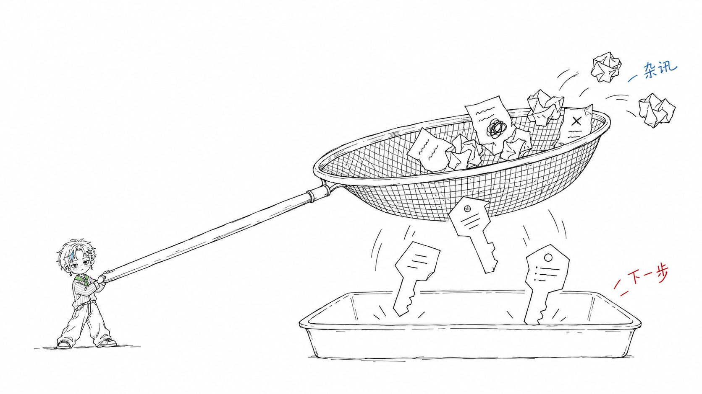
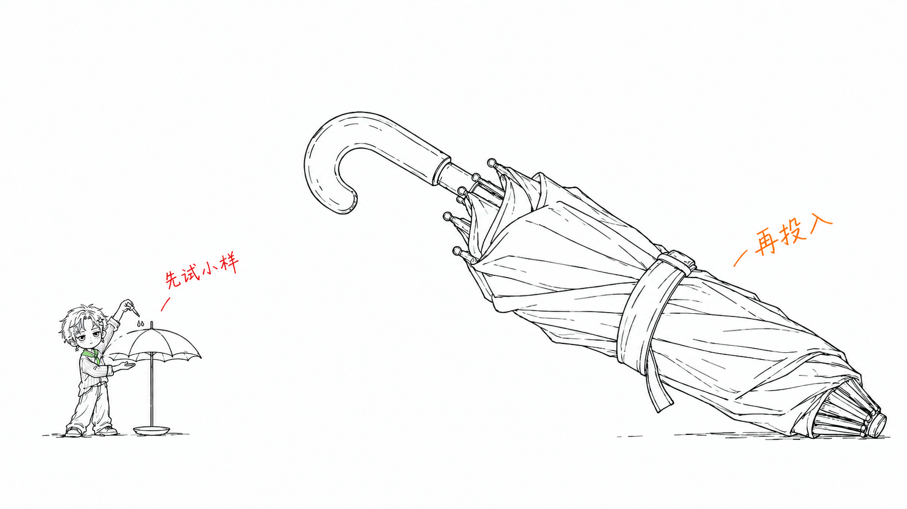

# Prompt Examples

下面这些 prompt 可以直接复制到 Codex 里使用。

8 个主题的小星案例及其完整生图记录见 [archive-xiaoxing/](archive-xiaoxing/README.md)。

## 只做配图规划

```text
Use $oooyi-illustrations 先不要生图。
请分析下面这篇文章哪里值得配图，输出 5 张左右的 shot list。
每张图写清楚：
- 放在哪个段落后
- 图的主题
- 核心意思
- 结构类型
- 小星在图里做什么（具体动作）
- 背景保持纯白，说明留白与主体安排
- 建议中文标注词

<粘贴文章>
```

## 文章正文配图

```text
Use $oooyi-illustrations 把下面这篇文章生成 4 张小星正文配图。
要求：16:9 横版、纯白背景、黑色手绘线稿、少量红橙蓝中文手写批注。
每张图只讲一个核心结构，不要做 PPT 信息图。

<粘贴文章>
```

## 长文配图策略

```text
Use $oooyi-illustrations 给这篇长文做配图策略。
不要平均配图，只挑认知锚点：核心判断、输入输出闭环、前后对比、常见坑、承接路径。
默认 6-8 张，先输出 shot list，不要生成图片。

<粘贴文章>
```

## 单个观点生成一张图

```text
Use $oooyi-illustrations 为这个观点生成一张 16:9 正文配图：

信任不是喊出来的，而是一块证据一块证据铺过去。

画面要怪诞但清爽，小小的小星必须亲手执行核心动作。
中文标注最多 5 个，短一点。
```

## 工作流主题

```text
Use $oooyi-illustrations 为"把一条原始素材加工成流量、信任、转化三种内容"生成一张图。
不要画正式流程图，不要复刻旧案例。
请重新发明一个怪诞但成立的隐喻，善用"小小的人 vs 巨型物件"的反差，让小星亲手执行核心动作。
```

## 改图：修正形象走样

```text
Use $oooyi-illustrations 这张图里小星的星星发夹画错了，
请对照基准图局部修正，其他内容保持不变。
不要新增任何文字或物件。
```

## 改图：增强小星参与感

```text
Use $oooyi-illustrations 这张图方向对，但小星有点像装饰。
请保持核心意思不变，重生成一版：让小星亲手执行核心动作。
画面保持手绘白底，CHARACTER LOCK 原样复用。
```

## 生成一组风格样片

```text
Use $oooyi-illustrations 输出 5 个不同主题的小星正文配图效果。
主题分别覆盖：信息过载、产品验证、内容复利、一人公司、信任建立。
每张单独生成，不要拼成一张。记得附基准图（仅取设计元素）并复用 CHARACTER LOCK（手绘版）。
```

## 当前 Skill 真实生成案例

两张配图均使用 Codex 内置 `image_gen` 生成。角色与画风依据 [oooyi-illustrations 当前 Skill](https://github.com/liaoyio/oooyi-illustrations/blob/0322759d512069efbc9860ff0785b35e7bceb76d/oooyi-illustrations/SKILL.md)，读取版本固定为 `0322759d512069efbc9860ff0785b35e7bceb76d`。

两张配图都附带以下角色基准。基准图只用于脸型、发型、配饰与服装设计，输出采用手绘线稿。

- [脸部特写](https://github.com/liaoyio/oooyi-illustrations/blob/0322759d512069efbc9860ff0785b35e7bceb76d/oooyi-illustrations/references/character/face-closeup.jpg)
- [全身基准](https://github.com/liaoyio/oooyi-illustrations/blob/0322759d512069efbc9860ff0785b35e7bceb76d/oooyi-illustrations/references/character/front-fullbody.jpg)

“信息过滤”最终生成使用 `num_last_images_to_include: 2`，对应上述两张基准。“先验证再投入”最终生成使用 `num_last_images_to_include: 3`，第三张为本次 [信息过滤成品](images/filtering.png)，仅用于校准小星的尺度、远景构图与线条密度，不沿用筛子等物件。

提示词保留实际调用原文；再次生成时，构图与细节可能不同。人物过大的早期尝试未选用，下面只记录最终成品的提示词。

### 信息过滤

小星双手摇动巨大的筛子，杂乱纸片留在上方，能打开下一步的钥匙形线索落入托盘。画面只保留“杂讯”和“下一步”两处短注。实际输出为 1672 × 941 PNG，小星全身约占画面高度的 28%。



<details>
<summary>完整生成提示词</summary>

```text
Generate a 16:9 horizontal 2048x1152 article sketch, PURE WHITE, thin slightly wobbly black pen line art. Very distant wide establishing shot. This is an illustration of giant objects with a TINY worker, not a picture of a character.
Reference images: face and full-body identify Xing ONLY; do not copy their framing, 3D style, proportions on canvas, lighting, textures or fills.

CHARACTER LOCK, hand-drawn render (reuse verbatim, do not alter):
Xing, a tiny cool boy drawn in loose black hand-drawn line art (slightly wobbly pen lines; NOT 3D, NOT photorealistic, NOT polished render; draw him as a BOY, never as a little girl): short tousled blonde hair with a blue-grey streak doodle in the front bangs; silver star hair clip doodle on the left side; star drop earring doodle on the left ear; boyish face, big eyes with a distant deadpan gaze, blush lines and freckle dots on cheeks; oversized pinstripe shirt doodle; green neckerchief (light green wash ONLY on the neckerchief); baggy jeans; white sneakers; cool expressionless face. Tiny figure in a wide shot: full body no more than ~1/3 of the canvas height (aim ~1/4); never a close-up.

CRITICAL SCALE: Despite the maximum above, make the boy MUCH SMALLER: only ONE SIXTH of the complete canvas height. Hair-to-shoes around 180 pixels out of 1152. The small full-body boy stays near the bottom; his head must be a tiny detail. No close-up, bust or portrait. Do not enlarge him to show accessories. The giant objects determine the composition. This ratio is essential.
Fine black sketch lines, open white interiors. Light green ONLY on his neckerchief and pale blue-grey ONLY in his one hair streak. All other character details black and white, including white outlined hair instead of yellow paint, freckles and blush as black dots and strokes, unfilled trousers and shirt. Keep a cool deadpan boy, not a girl or a grinning child. Star clip, earring, short hair, pinstripes and scarf remain minimally recognizable.
No texture, paper grain, shadows, gradients, 3D, realism, polished manga, vector art, PPT, boxes, title, background scenery or decorative icons. Objects plus boy span about half the canvas area, with at least 35% blank white and an especially large calm region above.

THEME: 信息过滤 — retain only clues that unlock the next action.
ONE PHYSICAL METAPHOR: A truly enormous long-handled mesh hand sieve occupies the middle-right of the white page. A few crumpled scribble-note scraps stay caught on the sieve while three gigantic key-shaped paper clues fall into one open tray underneath. The tiny full-body Xing stands far to the lower-left, personally shaking the long connected handle with both hands. His entire body is only as tall as ONE falling key-shaped paper clue, far smaller than the tray and sieve. The sieve is much wider than six Xing figures laid end to end. The figure's head starts around y=750 and feet end around y=930 on the 1152-high canvas. Objects occupy around x=450..1800, y=250..950. No arrow or extra figure.
Exactly TWO small handwritten side notes: blue "杂讯" at the discarded scraps, red "下一步" near the tray. These are not titles. All physical objects black outline on white. Minimal, sparse, airy, slightly imperfect pen lines. The boy performs the filtering with a steady deadpan face.
```

</details>

### 先验证再投入

小星在左下角站着，亲手向小伞滴水，并用另一只手探查是否漏水；巨大的折叠伞仍绑着，等待小样验证。画面只保留“先试小样”和“再投入”两处短注。实际输出为 1672 × 941 PNG，小星全身约占画面高度的 26%。



<details>
<summary>完整生成提示词</summary>

```text
Generate one NEW 16:9 horizontal Chinese article illustration in very fine slightly wobbly black hand-drawn line art on pure white. Wide establishing shot, huge white space. The new theme is 先验证再投入: use a cheap tiny test to check waterproofness before committing to an enormous rain shelter.

Input images:
Image 1: Xing face identity only.
Image 2: Xing outfit design only.
Image 3: the approved hand-drawn filtering scene, used ONLY as a reference for the TINY character scale at the extreme lower-left, the far wide-shot white-space composition and fine line density. Do NOT draw its sieve, keys, scraps or tray. Replace all conceptual objects with umbrellas. Make Xing even smaller than the boy in Image 3.

FIRST lay out the main giant object across the middle-right of the canvas: one ridiculously huge folded umbrella still tightly bundled with a tie, lying diagonally from upper-middle toward lower-right. It dominates the objects but leaves a large calm white region across the top-left. It is unopened, waiting for the sample test. Simple white interiors and black outlines, no gray shading.
THEN place a VERY TINY STANDING full-body Xing at the EXTREME LOWER-LEFT, just like the leftmost figure in Image 3 but smaller, hair to shoes only about 150-190 pixels on the entire 941-pixel-high image (well UNDER one quarter of the canvas height). His head is a minute detail, do not enlarge him for facial clarity. Feet fully visible, no kneeling or sitting, no central big character.
At his hands is a small test umbrella on a thin stand. The COMPLETE little test umbrella plus stand is taller than Xing's full body. With his right hand he squeezes a little eyedropper above its canopy, releasing three small black-outline droplets, while his left hand reaches under the canopy to test for leaks. One tiny empty saucer underneath stays dry. The testing action must be legible from the hands even though Xing is very small. No stool, no second person and no other objects.
The giant unopened umbrella is at least SIX TIMES the entire boy's height. Keep the boy spatially far from the giant umbrella: leftmost tiny boy, small test umbrella next to him, huge unopened umbrella on the right. No formal panels.

CHARACTER LOCK, hand-drawn render (reuse verbatim, do not alter):
Xing, a tiny cool boy drawn in loose black hand-drawn line art (slightly wobbly pen lines; NOT 3D, NOT photorealistic, NOT polished render; draw him as a BOY, never as a little girl): short tousled blonde hair with a blue-grey streak doodle in the front bangs; silver star hair clip doodle on the left side; star drop earring doodle on the left ear; boyish face, big eyes with a distant deadpan gaze, blush lines and freckle dots on cheeks; oversized pinstripe shirt doodle; green neckerchief (light green wash ONLY on the neckerchief); baggy jeans; white sneakers; cool expressionless face. Tiny figure in a wide shot: full body no more than ~1/3 of the canvas height (aim ~1/4); never a close-up.

Exactly TWO small hand-written side notes: red "先试小样" by the test and orange "再投入" by the still-bundled giant umbrella. No title or text at top-left, no other words, numbers, arrows or boxes.
Fine imperfect black pen sketch, pure white background, open unfilled forms and lots of white space. Light green only on the neckerchief, light blue-grey only on his front hair streak. All other marks on the boy and objects are black and white: white outlined tousled hair represents pale blonde, freckle dots and blush lines black, no skin color, no colored shirt or trousers. Keep the star hair clip, left star drop earring, pinstripe shirt, green scarf, baggy jeans and sneakers as minimal identity strokes. Calm distant cool boy, never a girl or a grinning child.
ABSOLUTE FINAL CHECK: the far-left full standing boy is visibly much smaller than one third of the image height, TARGET UNDER 200 PIXELS IN A 941-HIGH CANVAS. Do not fill blank areas by enlarging him. All objects plus boy occupy about 40%-60% of the canvas, leaving at least 35% completely empty white.
NO paper texture, noise, shading, cast shadow, gradients, 3D, realism, polished manga character art, vector commercial illustration, PPT, course slide, technical flowchart, dense instructions or repeated figures. No conveyor, bridge, star dough or fermentation jar.
```

</details>

生成后仅将滴管尖端与两滴水的淡蓝改成黑色轮廓和白色内芯。编辑使用 `referenced_image_paths`，唯一输入为本节初始生成图；`transparent_background: false`。完整编辑提示词见下方。

<details>
<summary>局部配色修正提示词</summary>

```text
Edit the provided hand-drawn umbrella illustration. Make ONLY this tiny color correction: change the pale blue on the eyedropper tip and the two small water droplets above the little test umbrella to thin BLACK outlines with WHITE interiors. There must be no blue color on the eyedropper or water.
Preserve everything else exactly: the tiny full-body Xing's size, position, standing pose, face, short hair, star clip and earring, freckles, pinstripe shirt, baggy trousers and sneakers; his pale blue-grey hair streak and light green neckerchief; red "先试小样" and orange "再投入" handwriting; the small test umbrella, saucer, giant diagonally folded umbrella, all linework, white space, pure-white background, original image dimensions and aspect ratio.
Do not redraw, resize, move, simplify or beautify anything. Do not add text, arrows, objects, colors, shading or texture. Keep fine black hand-drawn pen lines and white interiors; no 3D, realism or polished rendering.
```

</details>
