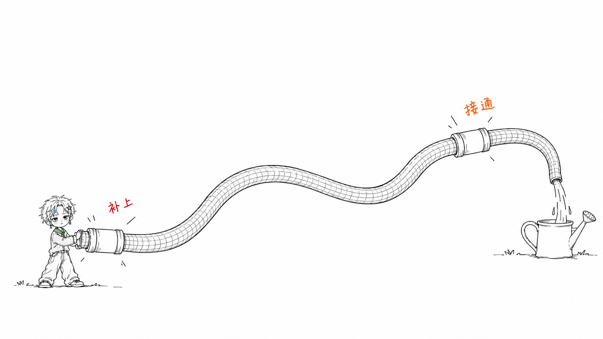
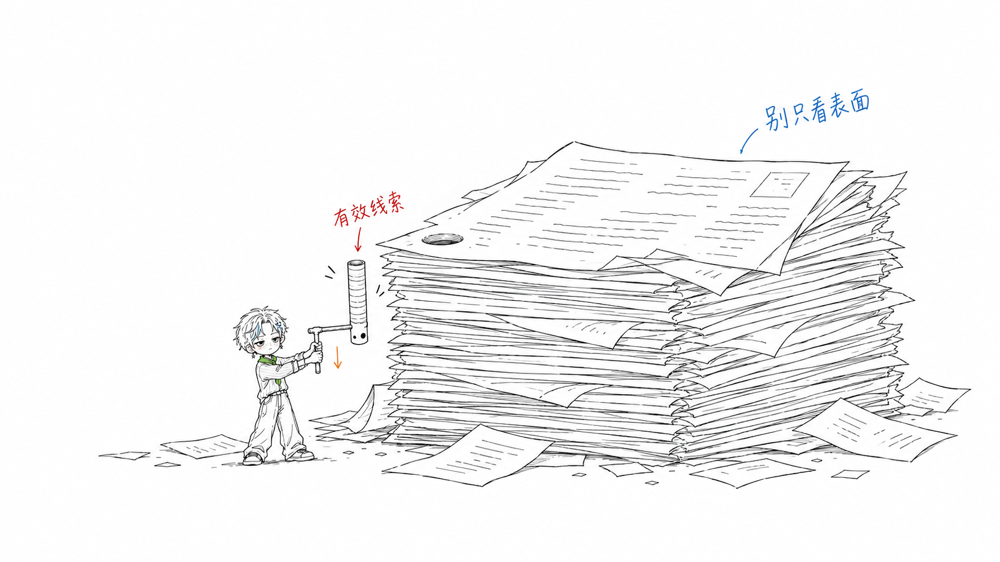
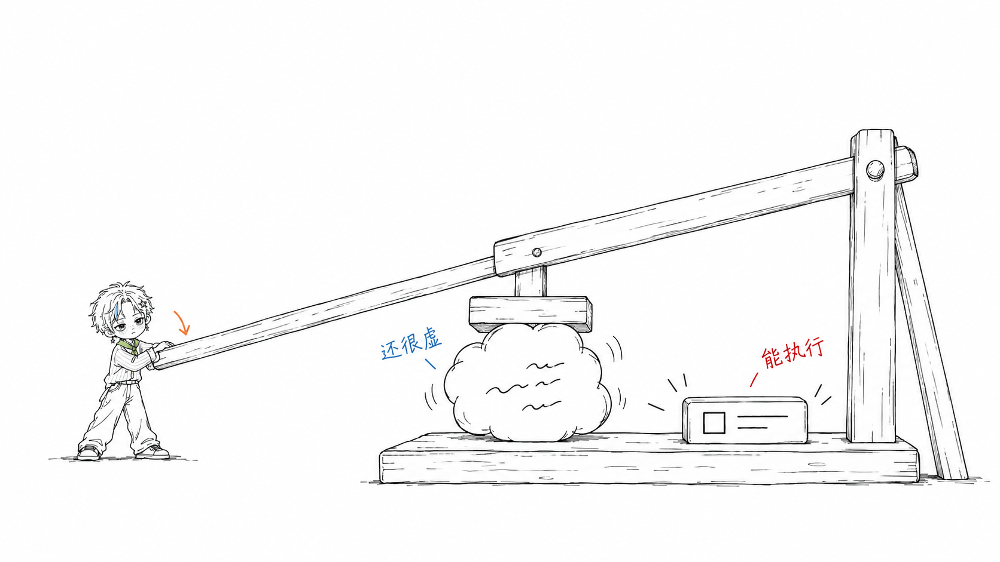

# 小星案例集

这 8 张图片按当前 `oooyi-illustrations` 的角色与画风规则生成，对应原案例的 8 个主题。它们都使用纯白画布、细黑手绘线和少量中文批注，由小小的小星亲手执行核心动作。这里的图片均为小星（Xing）案例。

完整生成提示词、参考来源和编辑记录见 [prompts.md](prompts.md)。需要校准画风时，选与当前问题相关的图片即可；不要默认加载整套，也不要照抄物件、构图或标注。角色身份以 [Skill 中的基准图](../../references/character/)为准。

## 补上断点

需求：`Use $oooyi-illustrations 为“两处断点都接通，链路才能继续”生成一张正文配图。`

## 按用途分类

需求：`Use $oooyi-illustrations 为“按要完成的任务分类，而不是把所有东西混在一起”生成一张正文配图。`

## 一份素材多用

需求：`Use $oooyi-illustrations 为“把一份素材拆成几种可用的成果”生成一张正文配图。`

## 承接路径

需求：`Use $oooyi-illustrations 为“给上一环的输出安排好下一步”生成一张正文配图。`

## 信息深挖

需求：`Use $oooyi-illustrations 为“继续往下挖，找到能支撑判断的信息”生成一张正文配图。`

## 想法落地

需求：`Use $oooyi-illustrations 为“把松散想法变成具体、能用的结果”生成一张正文配图。`

## 内容发酵

需求：`Use $oooyi-illustrations 为“让内容在持续积累中长出新价值”生成一张正文配图。`

## 信任建立

需求：`Use $oooyi-illustrations 为“用可检验的证据一点点建立信任”生成一张正文配图。`

